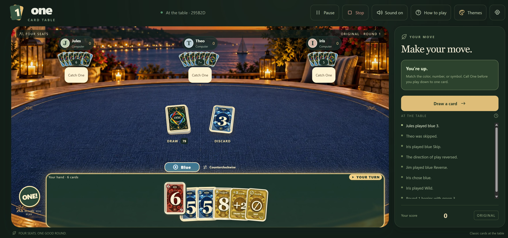
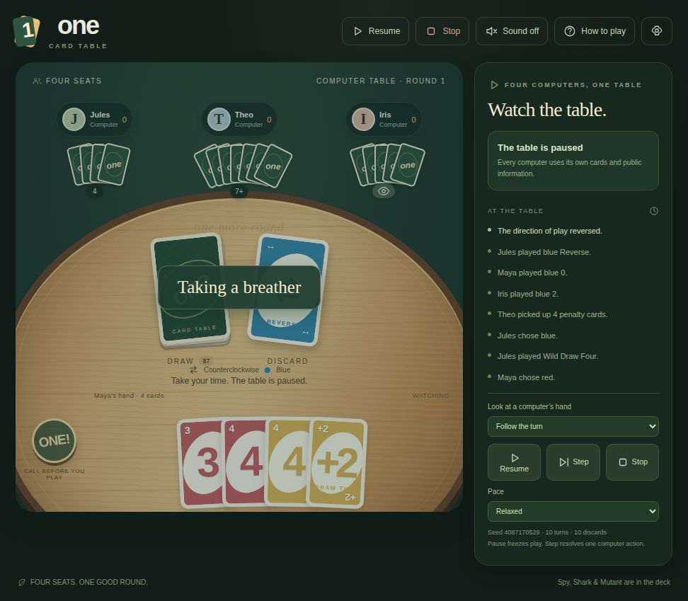
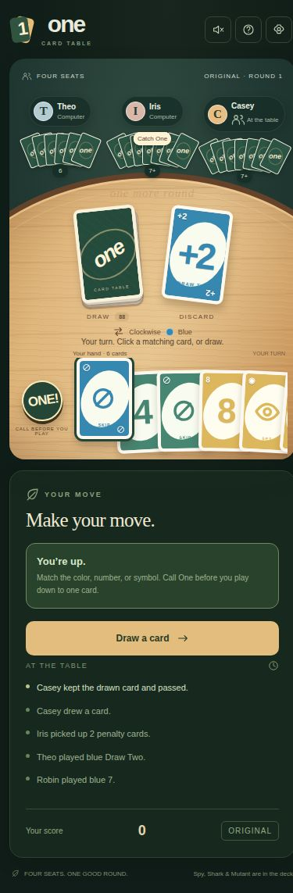

# One

**[Play One online — open the public game](https://one-card-table.jimerb.chatgpt.site)**

Enter your name and choose how many human players will join. Choose **1** to play against three computers, or **2–4** to play with friends. For multiplayer, share the QR invitation or copy the invitation link; each friend opens it, enters a name, and joins the same table. The person who created the table selects **Start now**, or waits for the countdown. Computers fill any remaining seats.

The public game works from phones, tablets, and computers. Players can be on different networks; no account, installation, or incoming firewall opening is needed. The online server coordinates the game and keeps each player's hand private. Enable **Sound** for the announcement, penalty, and winner sounds, and use its flyout to adjust volume or mute.

**Four seats. One good round.**

A modern, dark-mode card game for your browser. Play against computer opponents, invite friends with a QR code, or let four computers play while you watch. No accounts, downloads, or app installation for players.




## Pull up a chair

- **Solo:** you and three computer opponents, with Easy, Medium, and Hard difficulty.
- **Friends:** choose two, three, or four human seats. Guests scan the host's QR code, enter a name, and join from a phone, tablet, or computer.
- **Watch:** choose zero humans for four computers. Pause, resume, step through individual actions, change the pace, or stop the table.
- **Three ways to play:** Original, Challenge, and Team.
- **A few surprises:** optional Spy, Shark, and Mutant cards alongside the standard deck.
- **Follow every move:** glowing turn markers, a highlighted hand when it is your turn, a clear current-color badge, and cards sliding from the player to the discard pile.
- **Make it comfortable:** dark mode, fourteen table themes, Classic or Prism Atelier cards, keyboard controls, optional sounds and music, less motion, and higher contrast.

Every table has **four seats**. Computers fill the seats that humans don't take.

## Run the game locally

Install [Node.js](https://nodejs.org/) **22 or newer**, then:

```sh
git clone https://github.com/jimerb/One.git
cd One
npm ci
npm start
```

Open **[http://localhost:4444](http://localhost:4444)**. Enter your name, choose the number of human players, and start the table.

The default is a quick, one-round Original game with the special cards enabled and Hard computers. Open **Match length & pace** to change the round limit, point target, computer think time, or invitation window.

## Invite friends by QR when running locally

1. Choose **2, 3, or 4 humans**, including the host.
2. Select **Invite your friends** to display the QR code and invitation link.
3. Guests use the **same Wi-Fi or local network**, scan the code, and enter a unique name.
4. The host selects **Start now**, or waits for the invitation countdown. Unfilled seats become computers. **More time** resets the invitation window.

The server prints its local network address when it starts. Keep that server running while everyone plays. Guests don't need Node.js or any installed software.

If your computer has several network interfaces, you can set the address used in QR invitations:

```sh
ONE_PUBLIC_URL=http://YOUR-COMPUTER-IP:4444 npm start
```

To use another port:

```sh
PORT=5555 npm start
```

These environment-variable examples use macOS/Linux shell syntax. On Windows PowerShell, use `$env:PORT = '5555'` before `npm start`.

Publishing the code on GitHub does **not** deploy a playable website. One needs its Node.js server for shared games; a static GitHub Pages site alone cannot run it.

## The cards and the rules

Match the discard's **color, number, or symbol**. Empty your hand to win the round. Call **ONE!** before playing down to one card.

| Card | What happens |
| --- | --- |
| Skip | The next player loses a turn. |
| Reverse | Play changes direction. With two live players, it acts as a skip. |
| Draw Two | The next player takes two cards and loses a turn. |
| Wild | Choose the next color. |
| Wild Draw Four | Choose a color; the next player takes four and loses a turn, unless they challenge successfully. |
| Spy | Your card count is hidden while you hold it. |
| Shark | Circles the table until it bites a player for four cards and a lost turn. It can bite its own player. |
| Mutant | Becomes a replacement card from the draw pile and applies that card's effect. |

The standard deck has **108 cards**. Enabling Spy, Shark, and Mutant expands it to **120**.

### Drawing and passing

You may draw even when you can play. After drawing, play the new card, play another matching card from your hand, or **Keep & pass**. Draw penalties cannot be stacked.

### Wild Draw Four and challenges

Play Wild Draw Four to choose a color and give the next player a four-card penalty. It is a bluff if you still hold a card of the **previous active color**. A matching number or symbol in a different color does not count.

Only the player receiving the penalty may challenge, after the color choice and before accepting the cards.

| Their choice | Result |
| --- | --- |
| **Accept** | Draw four and lose the turn. |
| **Challenge succeeds** | The player who bluffed draws four. The challenger draws nothing and keeps the turn: play, draw, or pass. |
| **Challenge fails** | The challenger draws six in total and loses the turn. |

**Example:** Blue is active. Playing Draw Four while still holding a blue 7 is a bluff; holding only a red 7 is not.

If Draw Four is the last card in a hand, the four-card penalty settles before scoring, with no color choice or later challenge.

### Calling One and catching a missed call

Call **ONE!** before playing your second-to-last card. A missed call can be caught before the next accepted draw, play, or pass; a catch costs the offender two cards, once. Hard computers watch for visible missed calls even between two human turns. If nobody catches before the next accepted move, there is no penalty. Calling too early can also be challenged.

### Choose your match

| Mode | Scoring |
| --- | --- |
| **Original** | The round winner collects the points left in opponents' hands. |
| **Challenge** | Leftover points count against their owners. Reach the target and you're eliminated. The final two survivors reset scores for a final hand. |
| **Team** | Opposite seats are partners and share a score. Your partner's leftover cards don't count toward your winnings. |

Advanced limits preserve this edition's settings: zero rounds means unlimited; zero points disables the point target with a finite round limit. When both are zero, the target becomes 500. Challenge always uses unlimited rounds and a positive point target.

## Watch the computers

Choose **0 human players**, then **Watch the computers**.



- **Pause / Resume:** freeze or restart automatic play.
- **Step:** while paused, apply exactly one computer action. Drawing, playing, choosing a color, and calling One are separate actions.
- **Stop:** cancel automatic play and retain the last table for inspection.
- **Pace:** change the thinking delay.
- **Look at a computer's hand:** follow the active turn or inspect a chosen seat.

Computers use their own cards and public table information. They do not inspect opponents' hands, the draw pile, or private challenge results. Only computer-only observers can see every hand and the game seed.

## Keyboard controls

| Key | Action |
| --- | --- |
| Left / Right | Select a card |
| Space | Play the selected card |
| Enter | Draw, keep, or accept a penalty |
| U | Call One |
| R / G / B / Y | Choose a Wild color |
| 1 / 2 / 3 | Attempt a missed-call challenge on an opponent |
| Esc | Open or close settings |

In-game **How to play** explains the rules. **Themes**, beside the gear, opens a visual chooser for the four Standard tables and ten new boards: Velvet Lounge, Moonlit Conservatory, Orbital Observatory, Coastal Terrace, and Art Deco Theatre, each with a flat or seated view. Choose the Classic or illustrated Prism Atelier deck independently. Preferences stay on each device and survive reloads; friends can use different artwork at the same table. The chooser supports touch and tablet portrait/landscape layouts.

The gear holds audio and accessibility preferences. **Less motion** disables card flights and pulsing while retaining clear static turn highlights; the system reduced-motion preference is also respected.

Card sounds use a paper-slide effect. This local development copy can use the recovered CD card-arrival sample when it is present; the public repository uses a freshly synthesized paper-slide fallback and does not require the CD.

## Built to be checked

```sh
npm test
npm run simulate -- 50
```

The automated suite currently passes **59 checks**, covering special cards, challenges, scoring, hidden hands, fair computer decisions, lobby deadlines, disconnect recovery, pause/step/stop, HTTP endpoints, WebSocket authority, and independent decoding of the actual QR invitation.

The simulation command runs **300 full matches**: 50 seeds across three modes and two decks. The recorded validation run completed **214,435 actions**, with every match finished and card inventory checked throughout.

Browser testing also exercised separate host and guest hands, named joining, a guest card play, drawing/keeping, reload recovery, synchronized controls, and a phone-sized layout. Physical phone cameras have not yet been tested.

<details>
<summary>See the phone layout</summary>



</details>

## Inside the project

```text
app/                   Rules engine, computer strategy, room controller, server
public/                Browser interface and new card artwork
test/                 Behavioral and server tests
tools/simulate-one.js  Deterministic computer-match runner
docs/one-app.md        Detailed behavior and implementation decisions
docs/screenshots/     Desktop, phone, and observer screenshots
```

[Read the detailed game and implementation guide](docs/one-app.md).

One is a fresh implementation. All interface artwork here is newly created.

## Current limits

Rooms live in server memory: **restarting the server closes existing games**. A browser reload restores your seat through its saved credential. Disconnected humans have 30 seconds to reconnect before a computer continues their hand; returning with that credential restores human control.

The local setup described here is intended for a local network and stores rooms in server memory. The public link at the top runs a separate Sites-hosted edition with shared online tables and persistent room storage; it does not depend on the local server staying on. Both versions follow the recovered rule behavior where verified; neither claims exact reproduction of the original Windows interface or animation timing.
